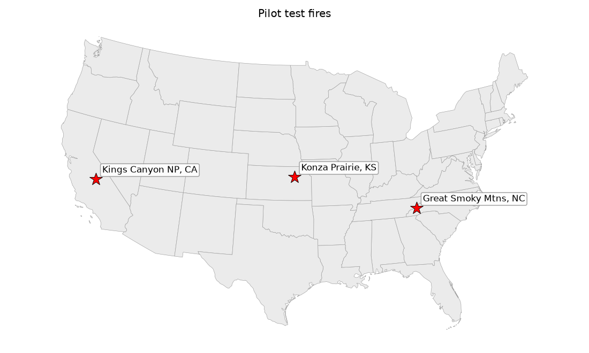
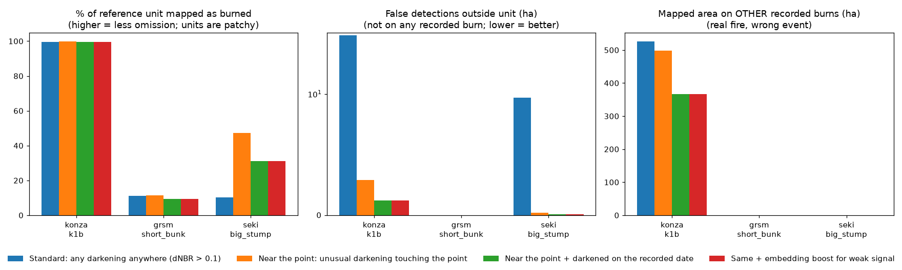
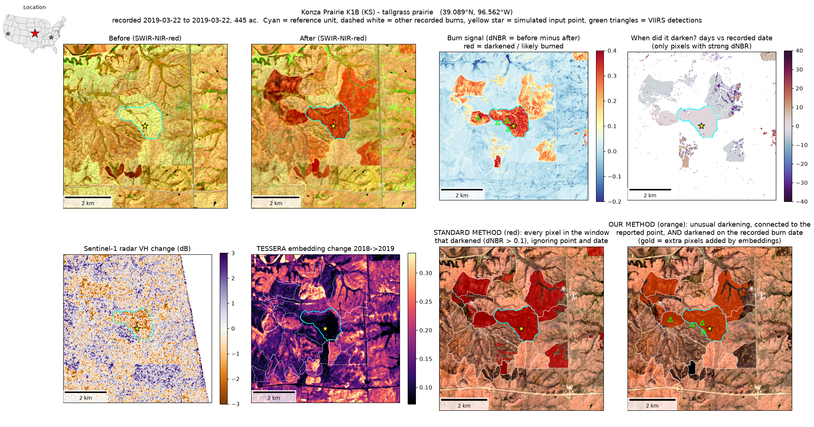
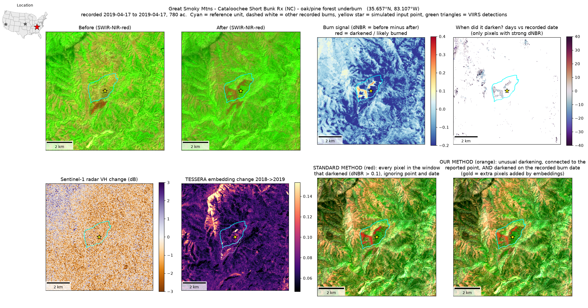
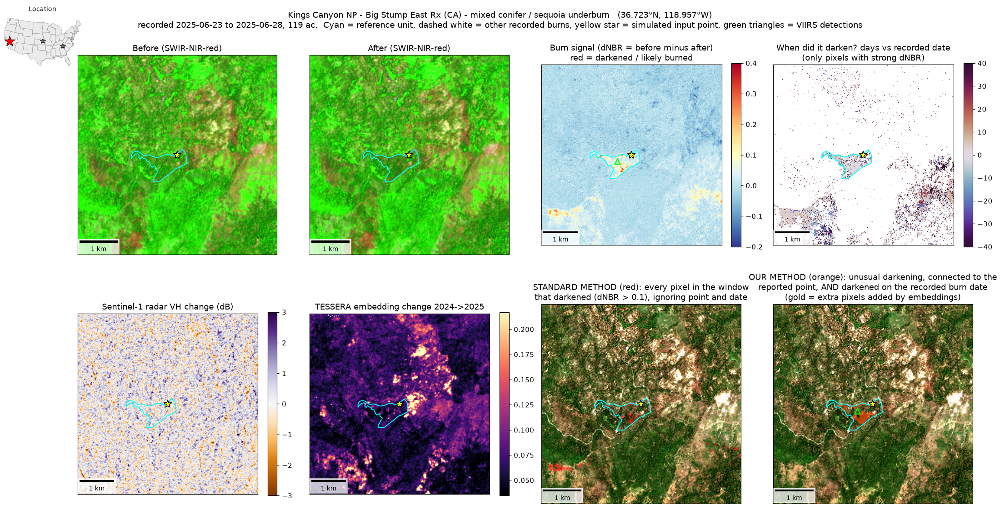
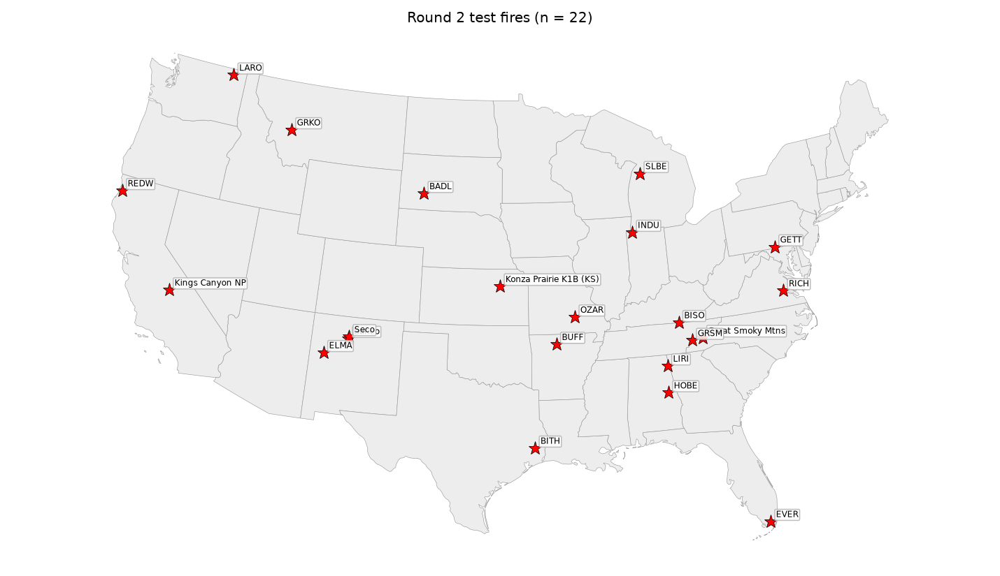
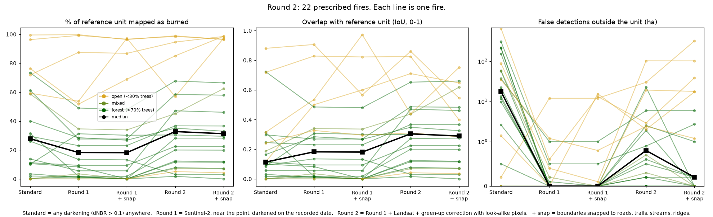
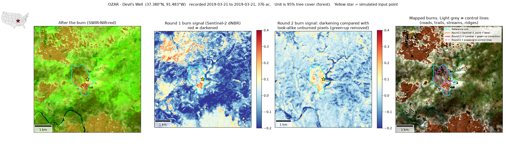
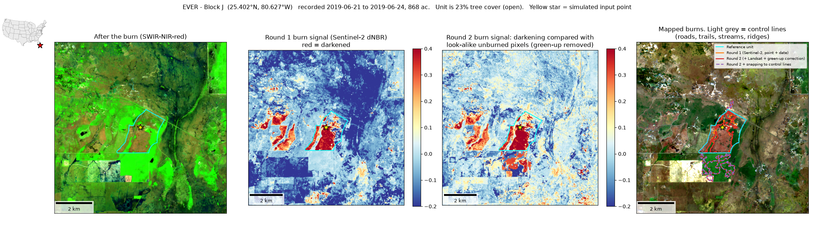
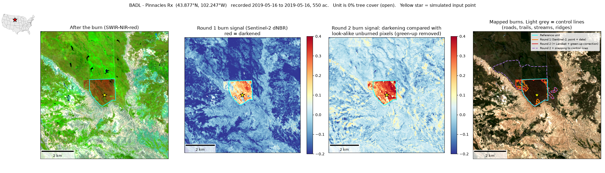

---
output:
  word_document: default
  html_document: default
  pdf_document: default
---
# Mapping prescribed fires from a point and a date: a pilot (3 fires, then 22)

## Abstract

Most prescribed-fire records, including TNC's, are a point, a date, and a reported size, with
no burned-area polygon. This pilot asked whether free satellite data can turn those records
into polygons automatically, with no hand work, in a way that could be repeated for hundreds
of fires across the US. It was tested in two rounds. Round 1 used three well-mapped fires to
develop the method. Round 2 used 22 fires picked automatically (14 forest, 2 mixed, 6 open,
including one Everglades wetland). In both rounds the method saw only a simulated, slightly
offset point, the dates, and the acres. The true perimeters were used only for scoring.

### Questions and answers

**Can free satellite data map a prescribed fire from a point, a date, and acres?**
Mostly, yes. The round-2 method found all 22 burns. For 17 of them it mapped at least 10% of
the unit, enough to be a useful polygon. It used Sentinel-2 and Landsat, which are free and
include the shortwave-infrared bands that show burning.

**Does it work everywhere?**
It works well in open country and only partly under trees. In grassland and open woodland,
about 90% of the unit was typically mapped. Under-canopy forest burns are the hard case: about
25% of the unit typically showed a signal, up from 9% in round 1. Some of that gap is real,
because low-intensity burns are patchy and the reference polygons are planned unit boundaries,
not mapped burned area. Field data would be needed to tell how much.

**Does starting from the recorded point and date cut false detections?**
Yes, sharply. A standard "any darkening anywhere" approach mapped 1,897 ha of false burned area
across the 22 fires. The point-and-date approach mapped 196 ha. The more cautious round-1
version mapped only 16 ha but missed more burned area. This is the omission-versus-commission
tradeoff from the Southeast FireMap experience, and the recorded point and date manage most of
it.

**Can it tell apart burns a few days apart?**
Not reliably. Burns about 10 or more days apart separated cleanly. Burns 2–4 days apart often
did not, because there was no clear Sentinel-2 or Landsat image in between. Daily Planet
imagery would solve this. That is a well-defined use for the remaining Planet credits, along
with sites where clouds hid the ground for 2–5 weeks after the burn.

**Does snapping to control lines (roads, trails, streams, ridges) help?**
Sometimes, but not on average. Where units are bounded by roads or canals and the fire fills
the unit, snapping was excellent. In the Everglades, overlap with the reference rose from 0.54
to 0.97. Where the free line data left large open areas, snapping overshot, adding about 290 ha
of false area at Badlands. Snapping also erased faint but real detections. Across all fires it
did not improve overlap (0.30 without, 0.29 with) and more than doubled false area.

**Do AI embeddings help?**
Yes, but not as a fire detector. Year-over-year embedding change did not show burns. The
embeddings were valuable for deciding which pixels are fair comparisons. Comparing each pixel
only with similar, distant pixels removed spring green-up, which produced most of the round-2
gains in eastern forests. A classifier trained on embeddings also picked out a held-out Konza
burn well, so embeddings may work as a supporting layer.

**Do radar and VIIRS active-fire data help?**
They help a little. Sentinel-1 radar showed the prairie burn but nothing under trees. VIIRS
confirmed 2 of the 3 round-1 burns. A missing VIIRS detection does not mean no burn.

**Can wetlands be included?**
Yes. The Everglades wetland burn was detected and mapped almost perfectly after snapping.
Masking wetlands out would have lost it.

**Can this be repeated for hundreds of points?**
Yes. Everything is free, needs no accounts or keys, and ran unattended in about 2–5 minutes per
fire on a laptop. A few hundred records is an overnight run.

### Lessons learned

1. **Start from the records, not wall-to-wall mapping.** The recorded point and date are the
   single biggest defense against false detections.
2. **Compare like with like.** Green-up and drying change whole landscapes. Comparing each pixel
   with similar unburned pixels, rather than the whole scene, recovered many hidden forest burns.
3. **Score carefully.** Reference perimeters are unit boundaries, so "% of unit mapped" is not a
   miss rate. Some "false" detections are probably real burns missing from the records.
4. **Keep the unsnapped polygon as the main product.** Offer snapping as an option, or test it
   against real burn-unit boundaries if partners have them.
5. **Use bulk, cloud-hosted data, not shared query services.** The free OpenStreetMap query
   service broke partway through the batch. Switching to Overture Maps files fixed it. The same
   rule applies to imagery (Microsoft Planetary Computer) and embeddings (Source Cooperative).
6. **Fix every setting before looking at results, and report non-detections.** All thresholds
   were set in advance and applied to every fire. A burn that isn't found is reported, not
   dropped.
7. **Clouds in the East are a real limit.** Some sites waited 2–5 weeks for a clear look.
   That is where daily imagery and radar matter most.
8. **Twenty-two fires show patterns, not program accuracy.** The next step is a larger run,
   ideally on TNC's own records, with results reported by cover type, region, and season.

## Introduction

Most prescribed fires are recorded only as a point (latitude/longitude), a date, and a
reported size. Wildfires have the MTBS perimeter dataset; prescribed fires have nothing
comparable. The idea being tested here is simple: if you know roughly *where* and *when*
a burn happened, can free satellite data draw the polygon?

The conversation that led to this pilot raised several concerns, and the pilot was built
around them:

- **Low-intensity burns under closed canopy** may leave little visible signal.
- **Looking harder finds more false positives** (the Southeast FireMap lesson: reducing
  omission raises commission). Dark-but-unburned features, wetlands, and other fires
  nearby are the usual culprits. Wetlands *do* burn after dry spells, so they cannot simply
  be masked out.
- **Reference perimeters are imperfect.** Most are planned burn-unit boundaries, not mapped
  burned area, so "percent of the unit mapped" is an estimate, not a miss rate.
- **It must be replicable across the US for hundreds of points**, so it uses only free,
  cloud-hosted data and no manual steps. (Planet imagery was deliberately left out; the
  TNC license ends in January 2027.)

The work was done in two rounds:

- **Round 1 (three fires)** worked out the method on three well-mapped burns.
- **Round 2 (22 fires)** ran a fully automatic version on 22 burns across the US
  (the three from round 1 plus 19 National Park Service burns). It adds Landsat,
  a correction for spring green-up, and an optional step that **snaps** mapped edges to
  control lines (roads, trails, streams, ridges). Every step ran with and without snapping.
  No hand work was done. See [Round 2](#round-2-22-fires-fully-automatic-with-and-without-snapping).

This is still a pilot. It shows what works and what doesn't, but 22 fires are not enough to
estimate accuracy for a whole program.

## The three test fires

The three were chosen to span easy to hard, using the most reliable public perimeters
that could be found.



| Fire | Ecosystem | Recorded date | Size | Reference source and quality |
|---|---|---|---|---|
| Konza Prairie, watershed K1B (KS) | Tallgrass prairie, burned every year | Mar 22, 2019 | 445 ac | Konza LTER burned-watershed map. Strong: units are bounded by roads and firebreaks, and burns usually fill them. |
| Cataloochee "Short Bunk" Rx, Great Smoky Mtns (NC) | Eastern oak/pine forest, steep terrain | Apr 17, 2019 | 780 ac | National Park Service perimeter, mapped with **differential GPS**. |
| Big Stump East Rx, Kings Canyon NP (CA) | Mixed conifer / giant sequoia, closed canopy | Jun 23–28, 2025 | 119 ac | CAL FIRE prescribed-burn layer (NPS record). Mapped acres match reported acres. |

## Methods (plain English)

### What the method is given

To mimic a TNC-style record, each fire is reduced to:
- a **point** placed 290–400 m from the unit's center in a random direction
  (real records are approximate),
- the **recorded burn dates**, and
- the **reported acres**.

The reference perimeter is hidden from the mapping step and used only to score it afterward.

### Free data used

| Data | What it adds | Access |
|---|---|---|
| **Sentinel-2** (10–20 m, ~5-day revisit) | The main burn signal. The "Normalized Burn Ratio" (NBR) compares near-infrared and shortwave-infrared light; burning lowers it. **dNBR** is NBR before minus NBR after. | Microsoft Planetary Computer, no key |
| **Sentinel-1 radar** | Sees through cloud and smoke | Planetary Computer, no key |
| **VIIRS active fire** (375 m) | Independent confirmation that something was burning | NASA FIRMS yearly archive, no key |
| **TESSERA embeddings** (10 m, annual) | AI summaries of each pixel's whole year, from Sentinel-1 + Sentinel-2 | Source Cooperative, no key |

### Steps for each fire

1. **Search window.** A square around the point, scaled to reported size (at least 5 km across).
2. **Clean Sentinel-2 images.** Every image from 60 days before to 45 days after the burn is
   loaded. Clouds and cirrus are removed. Sentinel-2's own cloud-shadow label often mislabels
   fresh char as shadow, so that label is only trusted when a real cloud is nearby.
3. **Before and after.** For each pixel, NBR is taken from the 3 clear looks just before the burn
   and the 3 just after. Their difference is dNBR.
4. **"When did it darken?"** This is the key addition. For each pixel, the method walks through
   *every* clear image and finds the biggest drop in NBR that **persists** into the next clear
   image, so one-off glitches are ignored. That gives a date bracket for each pixel's change.
   A pixel is **date-matched** if that bracket overlaps the recorded burn dates (±2 days).
5. **Radar, VIIRS, and embeddings** are pulled for the same window.
6. **Draw the polygon.** Four methods are compared to show the omission/commission tradeoff.
   The figures and tables use these names:

| Name | What it maps |
|---|---|
| **Standard** | Any pixel in the window with dNBR > 0.1 (a classic low-severity threshold). Ignores the point and date, the way wall-to-wall burned-area products work. |
| **Near the point** | Pixels that darkened unusually *compared with the rest of the window* (handles regional green-up or drying), and that are connected to the area within 1 km of the point. |
| **Near the point + date match** *(main method)* | Same, but each pixel must also have darkened on the recorded burn dates. |
| **+ embedding boost** | Same, plus weaker-signal pixels that are date-matched *and* show unusual embedding change. |

   All thresholds were set **before** looking at the results and are the same for every fire.
   Nothing was tuned to these three.
7. **Confidence and flags.** Each result gets a simple high/medium/low rating plus plain flags,
   for example "mapped area < 1/3 of reported" or "no VIIRS detection". A burn that isn't
   found is reported as **not detected** rather than silently dropped.

### How results were scored

Because the reference polygons are unit boundaries and low-intensity burns are patchy,
the scores focus on what can be trusted:
- **Detected?** At least 1 ha mapped inside the unit.
- **False detections outside the unit (ha).** Mapped area outside the unit and outside every
  other recorded burn that year, with a 1-pixel edge allowance. Prescribed fires rarely escape,
  so this is the most trustworthy error number.
- **Area mapped on other recorded burns (ha).** Real fire, but the wrong event.
- **% of unit mapped as burned.** An estimate of how much of the unit showed a signal.
  *Not* a miss rate.
- **Signal strength.** For each data source: how well does it tell the unit apart from clean
  background? (AUC: 0.5 = no better than chance, 1.0 = perfect. Values well below 0.5 mean
  a strong signal in the opposite direction.)

## Results



### Headline numbers (main method: near the point + date match)

| Fire | Detected? | % of unit mapped | False detections outside unit | Same number for **Standard** method | VIIRS confirms? |
|---|---|---|---|---|---|
| Konza prairie | Yes | 99.7% | 1.2 ha | 34.6 ha | Yes (4 detections, nearest 284 m from point) |
| Smokies oak/pine | Yes | 9.4% | 0 ha | 0 ha | No |
| Kings Canyon conifer | Yes | 31% | 0.1 ha | 9.7 ha | Yes (1 detection, 447 m from point) |

**1. All three burns were found**, including both under-canopy burns, from an approximate point
and a date. No false detections showed up outside the units with the main method.

**2. Using the point and the date cuts false detections sharply.** Compared with the standard
method, false detections fell from 34.6 to 1.2 ha at Konza and from 9.7 to 0.1 ha in Kings
Canyon. This is the omission/commission problem raised in the discussion: starting from
recorded points and dates avoids most of it.

**3. The grassland is easy. Under-canopy forest burns are partly visible.**
- *Konza:* essentially the whole unit shows a strong burn signal (dNBR separates it from
  background almost perfectly, AUC 0.996).
- *Kings Canyon:* about a third to a half of the unit shows a signal (31% with the date match;
  47% with the near-the-point method).
- *Smokies:* only about 10% of the unit. The reference unit includes unburned patches, so
  the true burned fraction is unknown. That is why field estimates of percent burned would be
  valuable.

**4. Spring green-up hides eastern understory burns, and the "when did it darken?" step helps.**
In the Smokies, leaf-out between the before and after images raised NBR across the landscape.
That masked the burn: simple dNBR did *no better than chance* at separating the unit from
background (AUC 0.43). The per-pixel timing approach did better (AUC 0.74). The approach was
built for exactly this case, but the signal is still weak.

**5. Date matching can separate burns about 10 days apart, but not 2–4 days apart.**
Konza recorded 36 other burned areas in 2019, on dates from February to November, which gave
a natural test:
- Watersheds burned **10 or more days** from the target: ≤1% of their pixels were wrongly
  matched to the target date.
- Neighbors burned **2–4 days earlier**: 27–93% were matched to the target date, because
  Sentinel-2 had no clear image in between. That is why the main method maps 367 ha of
  neighboring burns at Konza (real fire, wrong event). Daily imagery such as Planet would
  separate these, which is a concrete, well-defined use for the remaining Planet credits.

**6. Radar helps in grassland, not under trees.** Sentinel-1 showed a clear backscatter drop
in the burned prairie (about −0.8 dB; AUC 0.11 for VV, i.e., strong separation in the
negative direction). It showed nothing useful in either forest (AUC 0.42–0.53). This is
C-band radar; L-band radar (NISAR), which reaches through canopy, was not tested.

**7. VIIRS confirmed 2 of 3 burns,** and not the Smokies burn. As expected, a missing VIIRS
detection is not evidence that no burn happened.

**8. Embeddings: the obvious use failed, a different use looked promising.**
- *Year-over-year embedding change* did **not** work. At Konza the unit changed *less* than
  the background (AUC 0.14), because K1B burns every year, so 2018 and 2019 look alike. In the
  forests it was at chance (0.44–0.52). The embedding boost added at most 0.4 ha anywhere.
- *A classifier on the burn-year embeddings*, trained only on the *other* recorded Konza burns,
  picked out the held-out K1B unit well (AUC 0.93; 90% of unit pixels flagged). It also
  flagged 21% of nearby unburned prairie, and annual embeddings carry no burn date. In the two
  forests there were no other recorded burns nearby to train on, so this couldn't be tested.
  Embeddings look like a useful **supporting layer**, not a primary mapper.

**9. Confidence flags behaved sensibly.** All three were rated "medium". Konza was flagged
"mapped area > 2× reported", which correctly pointed to the neighboring burns. Both forest
burns were flagged "mapped area < 1/3 of reported", and the Smokies burn was also flagged
"no VIIRS detection".

### Per-fire figures

Each figure shows: before and after images, the burn signal, when each pixel darkened, radar
change, embedding change, the standard method, and the main method. The cyan outline is the
reference unit, the yellow star is the simulated input point, and dashed white outlines are
other recorded burns. Each panel has a scale bar. The small US map in the top-left corner
marks the fire (red star), and its coordinates are in the title.





## Round 2: 22 fires, fully automatic, with and without snapping

### Why round 2

Round 1 left three open questions. First, does the method hold up beyond three hand-picked
fires? Second, can the spring green-up problem in eastern forests be fixed? Third, do control
lines (the roads, trails, and streams that bound most burn units) help draw better edges?
Round 2 tests all three. It follows the rule that **nothing is done by hand**, so
it could be run on hundreds of points.

### How the 22 fires were chosen (automatically)

The fires were picked by a fixed rule, not by looking at imagery:

- The three round-1 fires, plus
- National Park Service prescribed burns from the public NPS fire perimeter service that were
  **mapped with GPS**, 60–1,200 acres, lasting 4 days or less, and not pile burns. At most one
  burn per park and five per NPS region were taken, largest first.

That rule produced 19 NPS burns. All are from 2019, because the public NPS layer only
contains prescribed-fire records for that year. All the imagery and terrain data exist for
2019. The one exception is the road, trail, and stream layer, which is current (2026) rather
than 2019. Most control lines are permanent, so this matters little, but a new road could
create a false edge.

Each fire again gets a simulated input point placed a few hundred meters from the unit center.



Land cover, from ESA WorldCover tree share inside each unit, splits the sample into
**14 forest** (>70% trees), **2 mixed**, and **6 open** (<30% trees) fires. One open unit
is an Everglades wetland (77% wetland).

### What was added in round 2

1. **Landsat 8 added to Sentinel-2.** More clear looks means a tighter date bracket for each
   pixel. Landsat shortened the gap between the burn and the first clear look after it at
   several cloudy sites, for example Big South Fork (13 to 4 days) and Horseshoe Bend
   (14 to 10 days). Some sites were still cloudy for weeks: the first clear look came 38 days
   after the burn at Little River Canyon, 19 at Ozark Riverways, and 16 at Buffalo River.
2. **Green-up correction using look-alike pixels.** In round 1, each pixel was compared with
   the whole window, which fails when forests leaf out unevenly across terrain. In round 2,
   every pixel is compared only with pixels of the **same kind** that are well away from the
   burn. "Same kind" comes from the previous year's TESSERA embeddings, grouped into 30 types
   (for example, north-facing oak forest or open pasture). On each image date, the typical NBR
   change of that type's distant pixels is subtracted. What remains is change that the
   surrounding landscape did *not* also go through. This is a new use for the embeddings: they
   don't detect fire, but they define fair comparisons.
3. **Control lines, from free national data.** Roads, trails, streams, water edges, and power
   lines come from **Overture Maps** (a free, open, cloud-hosted version of OpenStreetMap and
   other sources). Ridgelines come from the **Copernicus 30 m elevation model**. Together these
   lines cut the landscape into **cells**, much as burn units are laid out.
4. **Snapping (optional step).** For each cell no more than 3× the reported burn size:
   - if at least 40% of the cell was mapped as burned, the **whole cell is filled**;
   - if less than 10% was mapped, those few pixels are **removed** as likely noise;
   - otherwise the mapped pixels are kept as they are.

   All of these numbers were set before seeing any results and are the same for every fire.

### The five versions compared

| Name in figures | What it is |
|---|---|
| **Standard** | Any darkening (dNBR > 0.1) anywhere in the window. Ignores the point and date. |
| **Round 1** | The round-1 main method: Sentinel-2 only, near the point, darkened on the recorded date. |
| **Round 1 + snap** | Round 1, then snapped to control lines. |
| **Round 2** | Sentinel-2 + Landsat, green-up correction with look-alike pixels, near the point, darkened on the recorded date. |
| **Round 2 + snap** | Round 2, then snapped to control lines. |

Scoring is the same as in round 1. One measure was added: a **solid detection**, meaning at
least 10% of the unit was mapped. A detection of only 1 ha in a 300 ha unit is real but not
useful as a polygon.

### Round 2 results



| Version | Detected (≥1 ha in unit) | Solid detection (≥10% of unit) | Median % of unit mapped | Median overlap (IoU) | Total false detections outside units | Fires with >5 ha false |
|---|---|---|---|---|---|---|
| Standard | 18 of 22 | 16 | 28% | 0.11 | 1,897 ha | 14 |
| Round 1 | 20 | 12 | 18% | 0.18 | 16 ha | 1 |
| Round 1 + snap | 15 | 12 | 18% | 0.18 | 43 ha | 3 |
| **Round 2** | **22** | **17** | **33%** | **0.30** | 196 ha | 5 |
| Round 2 + snap | 21 | 17 | 31% | 0.29 | 509 ha | 6 |

Median % of unit mapped, by land cover:

| Cover | Standard | Round 1 | Round 1 + snap | Round 2 | Round 2 + snap |
|---|---|---|---|---|---|
| Forest (14 fires) | 12.5% | 8.9% | 7.5% | 25.4% | 25.4% |
| Mixed (2) | 29% | 19% | 17% | 26% | 35% |
| Open (6) | 74% | 71% | 92% | 90% | 97% |

Solid detections in forest: 10 of 14 for Standard, 6 for Round 1, and **11 for Round 2**.

**1. Round 2 found every burn and roughly tripled the useful signal in forests.**
All 22 burns were detected. In forest units, the median share mapped rose from 9% (round 1) to
25%. The largest gains came at eastern and southern forest sites where green-up or cloud had
hidden the burn:

| Fire | Round 1 | Round 2 |
|---|---|---|
| Ozark Riverways, Devils Well (MO) | 5.6% | 47% |
| Horseshoe Bend, NW Complex (AL) | 1.6% | 28% |
| Bandelier, Banco North (NM) | 1.8% | 20% |
| Buffalo River, Cash Bend (AR) | 1.0% | 12% |
| Smokies, Short Bunk (NC) (round-1 fire) | 9.4% | 22.5% |
| Smokies, Maple Branch (TN) | 52% | 85% |

**2. It costs some false detections, but far fewer than the standard method.**
False detections outside units rose from 16 ha (round 1) to 196 ha (round 2). The standard
method had 1,897 ha. Most of the round 2 increase came from four fires: Everglades (103 ha),
Badlands (30 ha), El Malpais (23 ha), and Grant-Kohrs Ranch (19 ha). In the Everglades, the
"false" area is next to a large burn in a landscape that burns often, so much of it is probably
real fire that wasn't in the NPS layer. That can't be confirmed without other records. The
median fire had essentially no false detections (under 0.5 ha in forest and mixed units).

**3. One fire got worse.** At Big Thicket, Sandhill (TX) the share mapped fell from 13.5% to
3%. The look-alike correction removed signal there. One possible reason is that the
comparison pixels of the same type were also darkening (for example, from unrecorded burns
or drying in the same pine type), but this wasn't diagnosed. A larger sample would show how
often this happens.

**4. Snapping to control lines helps in some places and hurts in others.**
- **Where it helps:** units bounded by roads, canals, and streams, where the burn fills the
  unit. In the Everglades wetland unit, snapping raised the overlap with the reference from
  0.54 to 0.97 (97% of the unit mapped). It also helped at Smokies Maple Branch (85% to 99%),
  Lake Roosevelt (overlap 0.44 to 0.62), and the open-cover class overall (median 90% to 97%).
- **Where it hurts:**
  - *Big open cells.* At Badlands, a large prairie cell bordered by few lines was filled, adding
    about 290 ha of false area.
  - *Cells that don't match the unit.* At Richmond (Malvern Hill), snapping lowered the overlap
    from 0.91 to 0.57.
  - *Weak, patchy burns.* The "remove cells under 10%" rule erased real but faint detections.
    In round 1, snapping cut detections from 20 to 15 fires (Little River Canyon, Sleeping Bear
    Dunes, Horseshoe Bend, and Buffalo River all dropped to zero). With round 2's stronger
    signal, snapping lost only one (El Malpais).
- **Bottom line:** with this free line data, snapping does not improve results on average
  (median overlap 0.30 without, 0.29 with) and it raises false detections. It is worth
  using as a **second product**, or only where the mapped burn already fills most of a
  closed cell, not as a default. Real burn-unit boundaries, if TNC or partners have them,
  would likely work much better than generic roads and streams.

**5. Wetlands can be mapped.** The Everglades burn (77% wetland) was found with both rounds and
mapped almost perfectly after snapping. This supports *not* masking wetlands out. The
colleague's point that wetlands burn after dry spells holds, and the method can see them.

**6. Grasslands and open woodlands remain easy. Under-canopy forest burns remain the hard
part.** Five of six open units were solidly detected by every method. The exception, Grant-Kohrs
Ranch (MT), showed only about 5% even in round 2. In forest, round 2 brings most burns to a
usable level, but a quarter of the unit mapped is typical. Whether that reflects the method or
real patchiness of the burn can't be told without field data.

### Example round-2 figures

Each figure shows the after-burn image, the round-1 burn signal, the round-2 (green-up-corrected)
burn signal, and the mapped polygons for round 1, round 2, and round 2 with snapping. Control
lines are drawn in light grey. Each panel has a scale bar, and the small US map marks the fire.

*Ozark Riverways: a forest burn hidden by green-up in round 1 and recovered in round 2.*


*Everglades: a wetland burn where snapping to canals and roads works very well.*


*Badlands: a prairie burn where snapping fills a large open cell and overshoots.*


Figures for all 22 fires are in `outputs_v2/<fire>/<fire>_panels.png`. Per-fire numbers are in
`outputs_v2/metrics_round2.csv`.

### A replicability lesson from round 2

The first version of the control-line step used the public OpenStreetMap query service
(Overpass). It was rate-limited and refused requests partway through the batch, and a backup
server was down. It was replaced with **Overture Maps**, which is read directly from cloud
storage with no server to overload. That fixed it. For hundreds of points, every data source
should be a bulk, cloud-hosted file (Planetary Computer, Source Cooperative, Overture), not a
shared query service.

## Caveats

- **Small samples.** Three fires in round 1, 22 in round 2 (only 2 in the mixed class). These
  show patterns, not program-wide accuracy.
- **References are unit boundaries.** "% of unit mapped" understates performance by an unknown
  amount when burns are patchy.
- **"False detections" may be real fires.** Burns not in the reference layers count as false,
  which likely inflates the Everglades number in particular.
- **Round 2 uses 2019 fires** because that's what the public NPS layer contains. Sentinel-2,
  Landsat 8, TESSERA, elevation, and land cover all cover 2019. Control lines are a 2026
  snapshot.
- **Settings were fixed in advance and not tuned.** Some of them (for example the 40% and 10%
  snapping cutoffs and the 3× cell-size limit) are guesses that a larger sample could improve.
- **Wetlands:** only one wetland burn was tested (Everglades), and it worked. Northeastern
  wetlands burned after dry spells still need their own test fires.
- **The confidence rating is a simple rule-of-thumb score**, not a calibrated probability.
- **Data quirks handled in code:** Sentinel-2 images after January 2022 need a reflectance
  offset removed. TESSERA only publishes an index for 2024, so the code builds index rows for
  other years from the file headers. The TESSERA reader needs `xarray==2025.6.1` with
  `zarr<3`.

## Is this replicable for hundreds of points?

Yes, and round 2 showed it in practice. All 22 fires ran unattended from the input record
alone (point, dates, acres), with no accounts, keys, or hand edits. Every data source is free
and cloud-hosted: Planetary Computer (Sentinel-2, Landsat, elevation, land cover), Source
Cooperative (TESSERA), Overture Maps (control lines), and, in round 1, NASA FIRMS (VIIRS). Each fire took
about 2–5 minutes on a laptop, so a few hundred points is an overnight run. A fire that fails
is logged and skipped rather than stopping the batch, and every fire is assigned a
cover class so results can be reported by ecosystem.

## Suggested next steps

1. **Run the round-2 method on a TNC record set** (or a larger reference set, such as every
   Konza year, the CAL FIRE layer, and state agency perimeters) and report detection and
   false-detection rates by cover class, region, and season. Use those to build the
   *detectability model* discussed earlier.
2. **Treat snapping as a second product, not the default.** Keep the unsnapped polygon as the
   main result. Offer the snapped version only where the burn already fills a closed cell.
   If partners have real burn-unit boundaries, test snapping to those instead of generic roads
   and streams.
3. **Check "false" detections against other records** (state burn permits, MTBS, VIIRS) to see
   how many are actually unrecorded burns, especially in fire-frequent landscapes like the
   Everglades.
4. **Look for delayed signals** (crown scorch, needle browning) 2–8 weeks after forest burns.
5. **Use Planet credits where they clearly add value:** separating burns a few days apart,
   small burns, and sites where clouds blocked the view for weeks (three round-2 sites
   waited 16–38 days for a clear look).
6. **Test L-band radar (NISAR)** for under-canopy burns.
7. **Get field estimates** of percent of unit burned for a handful of units, so the
   "% of unit mapped" numbers can be interpreted.

## How to run

```bash
python3 -m venv .venv && . .venv/bin/activate
pip install -r requirements.txt
python src/get_reference.py      # reference perimeters + simulated input records
python src/get_firms.py          # VIIRS detections near each fire
python src/pipeline.py konza_k1b grsm_short_bunk seki_big_stump   # mapping (no reference used)
python src/validate.py           # scoring + figures
python src/embedding_experiment.py

# Round 2 (22 fires)
python src/select_sample.py      # automatic fire selection + simulated input records
python src/pipeline_v2.py        # all fires; or list fire names. Skips fires already done.
python src/pipeline_v2.py --relines   # redo only control lines + snapping from saved layers
python src/validate_v2.py        # scoring, cover classes, figures
```

Round 2 does not use VIIRS. Adding it as a confirmation flag is a simple extension.

## Files

- `src/get_reference.py`: downloads the reference perimeters and builds the simulated input records
- `src/get_firms.py`: downloads VIIRS active-fire detections
- `src/pipeline.py`: the point + date to polygon workflow (free data only)
- `src/validate.py`: scoring and figures
- `src/embedding_experiment.py`: same-year embedding classifier test
- `src/tessera.py`: TESSERA reader (from the Source Cooperative bucket)
- `outputs/site_map.png`: map of the three pilot fires
- `outputs/<fire>/<fire>_panels.png`: per-fire figure
- `outputs/<fire>/polygons.geojson`: mapped polygons for each method
- `outputs/<fire>/run_log.json`: inputs, image counts, confidence rating and flags
- `outputs/<fire>/validation.json`, `outputs/metrics_all.csv`: scores

Round 2:

- `src/select_sample.py`: picks the 22 fires by a fixed rule and builds their input records
- `src/pipeline_v2.py`: Sentinel-2 + Landsat, look-alike green-up correction, control lines, snapping
- `src/validate_v2.py`: scoring, land-cover classes, and figures
- `outputs_v2/site_map_round2.png`: map of the 22 fires
- `outputs_v2/summary_round2.png`, `outputs_v2/summary_round2.csv`: summary across all five versions
- `outputs_v2/metrics_round2.csv`: every score for every fire and version
- `outputs_v2/<fire>/<fire>_panels.png`: per-fire figure
- `outputs_v2/<fire>/polygons.geojson`: mapped polygons for each version
- `data/cache/lines_<fire>.geojson`: control lines used for each fire
